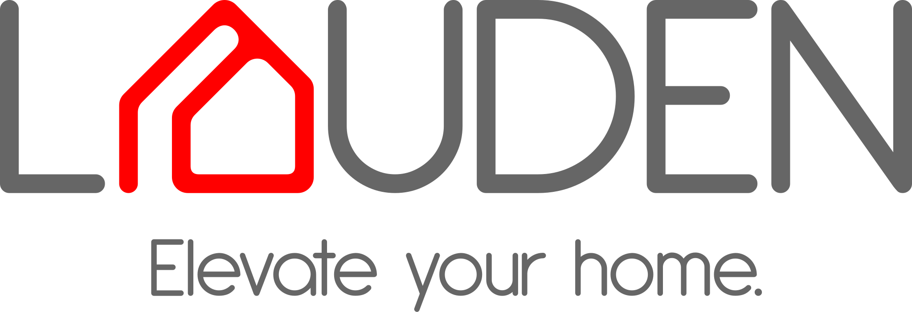

  <picture>
    <source media="(prefers-color-scheme: dark)" srcset="lauden-dark.svg">
    
  </picture>

<b>Open projects for the smart home.</b> 
Software, firmware and hardware: built for my own home, published for yours.

LAUDEN is where I publish what I build for the smart home. Every project
starts with something my own home needed and nothing I could find did well
enough. When a project is ready, it is published here, free and open.

## Projects

| Project | What it is | Status |
|---|---|---|
| [**Bellweather**](https://github.com/lauden-io/Bellweather) | Home Assistant integration: the weather here and now, measured, and a forecast scored against what was measured | available |
| [**PanelOS**](https://github.com/lauden-io/PanelOS) | Firmware for smart home wall panels: its own interface for Home Assistant and a voice satellite, on mainline Linux | available |

## How I build

- **Open.** Source code, design files and documentation are published,
  free to use and change under each project's licence.
- **Explained.** Every project says how it works and why it is built that
  way, so you can judge it yourself.
- **Secure by default.** The safest setting is the default. Where safety
  costs something, the choice is yours, and the option tells you what it
  costs.

## Public repositories

<!-- repos:start -->
| Repository | What it is | Language | Latest release | Licence |
|---|---|---|---|---|
| [**PanelOS**](https://github.com/lauden-io/PanelOS) | Open-source Linux firmware for smart home wall panels: its own interface for Home Assistant, drawn on the GPU, and a voice satellite. No browser, no cloud. | Slint | [v0.0.5](https://github.com/lauden-io/PanelOS/releases/tag/v0.0.5) | AGPL-3.0 |
| [**Bellweather**](https://github.com/lauden-io/Bellweather) | The weather here and now, measured, and the best forecast for your home, scored against what was measured. A Home Assistant integration for everyone, and the perfect companion for PanelOS. | Python | [v0.1.2](https://github.com/lauden-io/Bellweather/releases/tag/v0.1.2) | AGPL-3.0 |
<!-- repos:end -->

This list updates itself every day from GitHub.

## Get in touch

- **Questions, ideas, bugs:** open an issue in the project's repository.
- **Security problems:** please report them privately, never in a public
  issue: the repository's **Security** tab → **Report a vulnerability**.
